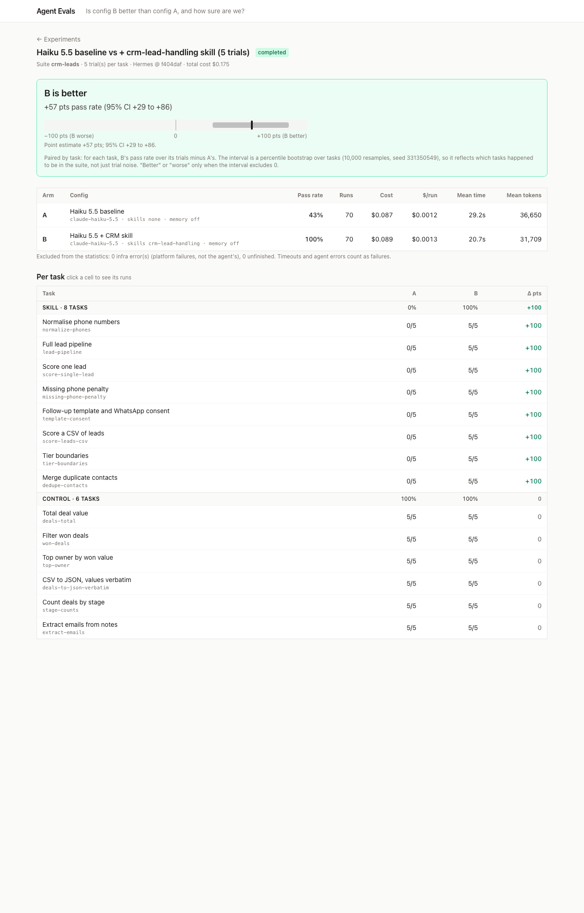

# Agent Evals

A local platform for answering one question about an agent: **did changing its configuration make it better, worse, or no different, and how sure are we?**

You define **tasks** (a prompt, fixture files, and graders that decide pass or fail) and **agent configs** (model, skills, memory, tools). The platform runs every task under two configs several times, each run in a fresh, sandboxed [Hermes Agent](https://github.com/NousResearch/hermes-agent). It then reports:

- the paired difference in pass rate, with a bootstrap confidence interval and a verdict;
- a per-task breakdown;
- a drill-down into every run: grader reasons, transcript and tool calls.

**The real experiment:** Haiku 5.5 vs Haiku 5.5 + a CRM playbook skill, 140 runs.

| | Pass rate |
|---|---|
| Baseline | 43% |
| With skill | 100% |

The verdict is **B is better, +57 pts (95% CI +29 to +86)**. The skill took its own tasks from 0/40 to 40/40 and changed nothing on the controls (30/30 in both arms). The experiment cost $0.175. → [docs/results.md](docs/results.md)



## Quick start

Requires **bun** ≥ 1.4, **Docker** (Docker Desktop, or colima on macOS) and an **Anthropic API key**.

```bash
cp .env.example .env      # then set ANTHROPIC_API_KEY
bun run start
```

Then open **http://localhost:5173**.

`bun run start` (see [scripts/start.sh](scripts/start.sh)):
1. Checks the prerequisites.
2. On first run only, installs Hermes at the pinned commit, which takes a few minutes.
3. Starts Postgres in Docker.
4. Builds the project, then runs the API on :3000 and the UI on :5173.

The API applies DB migrations, loads `suites/` and `configs/`, and starts the experiment worker. Ctrl-C stops the API and the UI; `docker compose down` stops Postgres.

The first experiment pulls the sandbox image (`python:3.13-slim`) once.

## Using it

1. **Launch** on the Experiments page: pick a suite, config A (the baseline), config B (the candidate) and the trials per task, then *Create and start*. Runs execute 4 at a time (`RUNNER_CONCURRENCY`).
2. **Read the result** on the experiment page:
   - the verdict sentence and the confidence interval drawn against zero;
   - pass rate, cost, latency and tokens for each arm;
   - a per-task table grouped into *skill* tasks and *controls*.
3. **Find out why** by clicking any A or B cell in the per-task table to list those runs, then opening one. The run page shows:
   - the grader checklist first, with each grader's reason, e.g. `expected N6 = "INVALID", got "5820011228"`;
   - each session's final response and full transcript, including tool calls;
   - the memory snapshot, when memory is on;
   - the exact config and task snapshot the run used.

The same data is available over HTTP:

```bash
curl localhost:3000/api/suites                     # also /api/suites/:slug, /api/configs
curl -X POST localhost:3000/api/experiments -H 'content-type: application/json' \
  -d '{"name":"demo","suite":"smoke","configA":"haiku-baseline","configB":"haiku-crm-skill","trialsPerTask":2}'
curl -X POST localhost:3000/api/experiments/<id>/start   # /cancel to stop
curl localhost:3000/api/experiments/<id>/analysis        # verdict, delta, CI, per task
curl "localhost:3000/api/experiments/<id>/runs?task=normalize-phones&arm=A"
curl localhost:3000/api/runs/<runId>                     # graders, transcript, snapshots
```

## Defining tasks and configs

Both are YAML files, loaded and validated when the API starts. A typo in a field name stops the boot with the file name and the path to the field, e.g. `crm-leads.suite.yaml → tasks[3].graders[1].pattern: …`.

```yaml
# suites/<name>.suite.yaml
slug: crm-leads
name: CRM lead handling
tasks:
  - slug: score-single-lead
    category: skill            # skill | control | memory
    prompt: |                  # or `sessions: [...]` for multi-session (memory) tasks
      ... write lead.json as {"score": <integer>, "tier": "<tier>", "template": "<code>"}
    fixtures:                  # planted in the agent's workspace
      leads.csv: { file: fixtures/crm/leads.csv }
    graders:
      - { type: json_field, target: "file:lead.json", path: score, equals: 80 }
      - { type: tool_called, tool: skill_view, required: false }   # diagnostic only
```

**Grader types:** `contains`, `regex`, `json_field` (`equals` / `oneOf`), `file_exists` and `tool_called`. A run passes only if **all required graders** pass. Graders with `required: false` are evidence for the run page and don't affect pass or fail.

```yaml
# configs/<name>.yaml
slug: haiku-crm-skill
name: Haiku 5.5 + CRM skill
model: claude-haiku-5.5
skills: [crm-lead-handling]    # folders in suites/skills/<name>/SKILL.md
skillMode: installed           # installed: the agent decides to load it | pinned: always in the prompt
memoryMode: off                # off | on | seeded (with memorySeed)
toolsets: [file, terminal]
maxIterations: 30
runBudgetS: 300
```

**Shipped content:**
- **Suites:**
  - `crm-leads`: 8 skill tasks and 6 controls, the main experiment.
  - `memory`: 4 two-session tasks.
  - `smoke`: 2 tasks.
- **Configs:** `haiku-baseline`, `haiku-crm-skill`, `haiku-memory`.
- **Golden answers:** every task has a hand-checked golden attempt in `suites/golden/`. A test makes sure the golden attempt passes and an empty attempt fails, so a broken task is caught before it gets counted as an agent failure.

## Repository layout

```
apps/api            NestJS API + experiment worker (TypeScript)
  src/catalog         YAML suites/configs → validated snapshots → DB
  src/experiments     create/start/cancel, analysis, run detail
  src/runner          queue (Postgres SKIP LOCKED), plan → spawn Hermes → classify → grade → persist
  src/grading         deterministic graders
  src/analysis        paired bootstrap statistics
  src/pricing         token → USD
apps/web            Vue 3 UI (experiments, results, run detail)
packages/shared     zod schemas + API types shared by api and web
runner/             Hermes setup (pinned commit) and driver.py (one run = one process)
suites/             task suites, fixtures, skills, golden attempts
configs/            agent configs
docs/               design, results, limits, costs, assumptions
```

## Tests

```bash
bun run test        # unit tests: api (graders, stats, planner, classifier, catalog, shipped suites, …) + web (verdict formatting)
bun run typecheck
cd apps/api && bun run test:int   # queue integration tests against Postgres (needs the compose DB)
cd apps/api && bun run test:live  # one real Hermes run end to end (spends a few tenths of a cent)
```

The tests concentrate where a bug would quietly change a conclusion rather than crash. Those areas are grading, statistics, the run planner (both arms must differ only in the variable under test), the failure classifier, and the shipped task content. [docs/design.md](docs/design.md#testing-strategy) explains the reasoning.

## Docs

- [Design](docs/design.md): architecture, run lifecycle, statistics, failure handling, sandbox, testing strategy.
- [Results](docs/results.md): the real experiment, the prediction made beforehand, what was learned, raw data.
- [Known limits](docs/limits.md)
- [Costs](docs/costs.md)
- [Assumptions](docs/assumptions.md)
