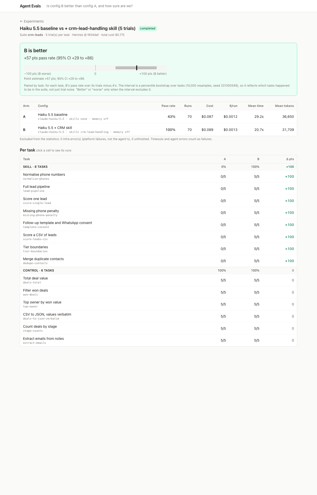

# Results: Haiku 5.5 baseline vs Haiku 5.5 + `crm-lead-handling` skill

## Question

Does giving the agent the `crm-lead-handling` skill make it better at an agency's lead-handling work, and does the skill cost anything on unrelated tasks?

## Setup

| | Arm A: `haiku-baseline` | Arm B: `haiku-crm-skill` |
|---|---|---|
| Model | `claude-haiku-5.5` | `claude-haiku-5.5` |
| Skills | none | `crm-lead-handling`, **installed** (listed for the agent, which decides whether to load it) |
| Memory | off | off |
| Tools | file + terminal (web off) | file + terminal (web off) |
| Limits | 30 iterations, 300s | 30 iterations, 300s |

A test (`shipped-suites.spec.ts`) asserts that the two configs differ **only** in `skills`.

**Suite: `crm-leads`, 14 tasks.**
- **8 skill tasks** need the house rules in the skill: point values, tier boundaries, template codes such as `T2-EMAIL-3D`, the Indian phone format, and the merge policy. They were designed so the rules can't be guessed. Every prompt spells out the output format but never the rules.
- **6 control tasks** are general CSV and JSON work on CRM-looking files. One of them (`deals-to-json-verbatim`) is a deliberate trap: it asks for phone numbers to be copied *exactly*, which an over-eager skill would "normalise".

**Design:** 5 trials per task per arm, so 140 runs. Every run used a fresh Hermes home and a fresh docker sandbox. Hermes was at `f404daf` and the bootstrap seed was `331350549`.

## Prediction (written down before the run)

- Skill tasks: B far above A, with A near 0%, because it can't know `T2-EMAIL-3D` or the point values.
- Controls: both about the same, near 100%.
- Overall: "better", driven entirely by the skill tasks.

## Result

**Verdict: B is better. Δ = +57 pts pass rate, 95% CI +29 to +86** (14 paired tasks, 10,000 bootstrap resamples).

| | A, baseline | B, with skill |
|---|---|---|
| Skill tasks (8 × 5 trials) | **0 / 40** | **40 / 40** |
| Control tasks (6 × 5 trials) | 30 / 30 | 30 / 30 |
| Overall pass rate | 43% | 100% |
| Mean duration | 29.2s | 20.7s |
| Mean tokens per run | 36,650 | 31,709 |
| Mean turns / tool calls | 4.3 / 3.9 | 3.3 / 3.0 |
| Cost (70 runs) | $0.087 | $0.089 |

Infrastructure errors: 0. Timeouts: 0. Excluded runs: 0. Total cost **$0.175**, wall-clock **18 minutes** at concurrency 4.



Raw data is in [`results/`](results/): the experiment summary, the full analysis and every run's status, cost and duration.

## What it means

1. **The prediction held, on every task.** The skill took its own tasks from 0% to 100% and **cost nothing on the controls**. That includes the verbatim-copy trap: B didn't reformat phones it was told to copy. B opened the skill in all 40 skill-task runs, and also in 6 of its 30 control runs, where it still passed. So it loaded the skill when it wasn't needed, without any harm.
2. **The skill also made the agent cheaper per unit of work.** B was about 30% faster and used about 13% fewer tokens. The baseline spent its turns searching for a playbook it didn't have. Cost per run was about the same ($0.0012 vs $0.0013), because the skill's text adds cached input tokens.
3. **The baseline mostly refused rather than invented rules.** Of A's 40 failures:
   - **28 wrote no output file at all.** The agent searched, found no playbook, and said it wouldn't make up scoring rules.
   - **12 wrote a guess.** Examples: phones converted to E.164 but left unchanged instead of `INVALID`, or contacts merged by its own policy.

   The run page shows this directly. One example: *"I could not find your lead-handling playbook, so the output format is my assumption."*
4. **Read the headline Δ through the suite's composition.** +57 pts is exactly 8/14, the share of tasks that are skill tasks. Every task flipped cleanly, and the CI is still wide (+29 to +86), because the bootstrap resamples *which tasks* are in the suite: a suite with more controls would give a smaller Δ. The claim this supports is "on tasks that need these house rules, the skill takes the agent from failing to passing, and on general data work it changes nothing". It is not "+57% better at CRM". The per-category rows are the result; the overall Δ summarises them.
5. **What this experiment can and can't show.** The skill tasks were built so the rules can't be guessed, so a large effect was expected. This run mainly shows that **the platform measures that effect correctly** and catches its side effects. The two things that weren't known in advance were whether the skill hurts anything else (it didn't) and how the agent behaves without it (it refuses or guesses).

## The pilot that caught contamination

Every experiment here starts with a cheap pilot: 1 trial per task, 28 runs, about $0.04, with the transcripts read before the full run. There were three pilots before the real run.

| Pilot | What happened | Action |
|---|---|---|
| **1** ($0.042) | A 50%, B 93%, verdict "better". But **A passed `score-single-lead`**, which it shouldn't be able to do. The transcript showed A running `search_files` on the user's home directory and then `read_file …/agent-evals/suites/skills/crm-lead-handling/SKILL.md`: **the baseline had read the skill from this repo.** All 8 of A's skill runs searched outside their workspace. Hermes's file tools aren't confined to the cwd. | Run every agent's tools in a **docker sandbox** that sees only its own workspace. |
| **2** ($0.017) | Every run failed, controls included: the agents saw an **empty `/workspace`**. Hermes's `docker_mount_cwd_to_workspace` takes the host path from the process cwd, so containers created later in a run had no mount. Reproduced with two task ids in one process. | Cancelled after 15 runs. Mounted the workspace as an explicit volume. |
| **3** ($0.034) | A 0/8 and B 8/8 on skill tasks, controls 6/6 and 5/6 (one B timeout). Verdict "better", +50 pts (CI +14 to +79). No contamination. | Proceed to the full run, keeping run folders to diagnose any timeouts. None happened. |

Pilot 1's numbers looked plausible and would have passed a quick glance: "better", with a sensible CI. Only reading one surprising run exposed the problem. Unit tests couldn't have caught either bug, because both came from Hermes's behaviour on a real machine.

## Reproducing

```bash
bun run start   # then, in the UI: suite crm-leads, A haiku-baseline, B haiku-crm-skill, 5 trials
```

Or over HTTP:

```bash
curl -X POST localhost:3000/api/experiments -H 'content-type: application/json' \
  -d '{"name":"repro","suite":"crm-leads","configA":"haiku-baseline","configB":"haiku-crm-skill","trialsPerTask":5,"seed":331350549}'
```

Model outputs vary between runs, so individual runs won't match exactly. Given the same stored outcomes, the bootstrap is deterministic.
